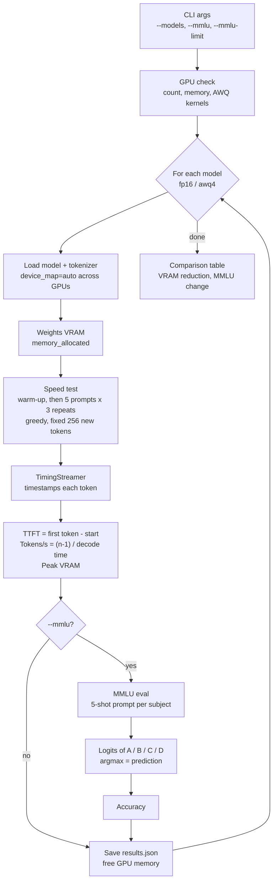

# llama-3-benchmark
Llama-3-8B fp16 vs 4-bit AWQ benchmark. AWQ cuts weight memory from 16.1 GB to 5.7 GB (−64%) at an MMLU cost of X points. Measures TTFT, throughput, VRAM and 5-shot MMLU.
# Llama 3 Performance Benchmarking

Benchmarks Llama-3-8B-Instruct inference at 16-bit precision against 4-bit AWQ quantization on a single GPU.

## What it measures

| Metric | How |
|---|---|
| Time to first token (TTFT) | A custom streamer timestamps the first generated token (prefill latency) |
| Throughput (tokens/s) | Tokens after the first ÷ decode time, with a fixed output length and greedy decoding |
| VRAM | `torch.cuda.memory_allocated` after load (weights) and peak during generation |
| MMLU accuracy | k-shot multiple choice, scored by the log-likelihood of the answer letters A/B/C/D |

Each prompt runs several times after warm-up, and the median is reported.

## Architecture 


## Setup

```bash
pip install -r requirements.txt
huggingface-cli login   # Meta-Llama-3 is gated: accept the licence on Hugging Face first
```

You need at least 24 GB of GPU memory in total for the fp16 model. The script splits the model across all visible GPUs, so Kaggle's free "GPU T4 x2" (2 × 16 GB) works.

At startup the script reports whether AutoAWQ's GPU kernels (`awq_ext`) are installed. Without them, AWQ still runs but its speed is not representative.

### Kaggle (free, 2 × T4)

1. New notebook → Settings → Accelerator: **GPU T4 x2**, Internet: **On**.
2. Upload this folder as a dataset, or upload the zip and unzip it.
3. Add your Hugging Face token under Add-ons → Secrets as `HF_TOKEN`, then:

```python
from kaggle_secrets import UserSecretsClient
from huggingface_hub import login
login(UserSecretsClient().get_secret("HF_TOKEN"))
```

```bash
!pip install -q autoawq datasets
!python benchmark.py --mmlu --mmlu-limit 20
```

## Run

```bash
python benchmark.py                                # speed + memory, fp16 and AWQ
python benchmark.py --mmlu --mmlu-limit 20         # add MMLU, 20 questions per subject (quick)
python benchmark.py --mmlu                         # full MMLU (~14k questions, slow)
python benchmark.py --models fp16 --max-new-tokens 512
```

The script prints a comparison table and writes `results.json`.

## Results

<!-- Paste the table printed by the script here -->
