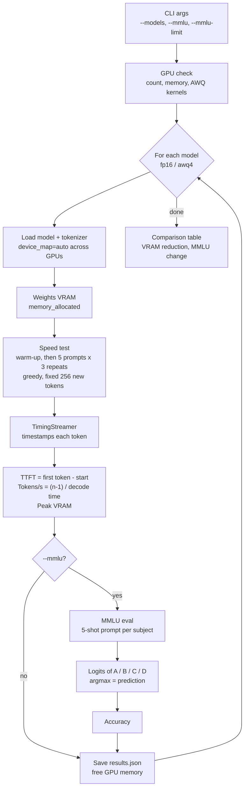

# Llama 3 Quantization Benchmark

Benchmarks Llama-3-8B-Instruct at 16-bit precision against 4-bit AWQ quantization, measuring time-to-first-token, decode throughput, VRAM and 5-shot MMLU accuracy. The model can run on one GPU or be split across several.

**Result: 4-bit AWQ cuts weight memory by 64% (16.1 GB → 5.7 GB) for a 3.9-point MMLU drop (68.8% → 64.9%).**

## Results

Hardware: Kaggle, 2 × Tesla T4 (32 GB total). MMLU: 5-shot, 1,140 questions (the first 20 of each of the 57 subjects). Speed: 15 timed generations of 256 tokens per model.

| Model | Weights VRAM | Peak VRAM | 5-shot MMLU | TTFT | Throughput |
|---|---|---|---|---|---|
| fp16 | 16.1 GB | 16.2 GB | 68.8% | 88 ms | 14.3 tokens/s |
| AWQ 4-bit | 5.7 GB | 5.8 GB | 64.9% | – | – |

Raw output: [`results/results_fp16.json`](results/results_fp16.json), [`results/results_awq.json`](results/results_awq.json)

Notes:
- VRAM is shown in GB (10⁹ bytes); `results.json` stores GiB (1024³ bytes).
- AWQ speed is omitted. AutoAWQ's GPU kernels (`awq_ext`) were not available for the Python/PyTorch versions on Kaggle and Colab, so AWQ ran on a slow fallback path (~4 tokens/s), which isn't representative. Accuracy is unaffected.
- MMLU on a 20-per-subject subset has a standard error of about ±1.4 points.
- On two GPUs, peak VRAM is the sum of each GPU's peak, which slightly overstates the true combined peak.

## How it works



For each model, the script loads the weights and records how much memory they take, runs the timed speed test, and optionally runs MMLU. It saves results after each stage, frees the GPU, and moves to the next model. After the last model, it prints a comparison table.

## What it measures

| Metric | How |
|---|---|
| Time to first token (TTFT) | A custom streamer timestamps the first generated token (prefill latency) |
| Throughput (tokens/s) | Tokens after the first ÷ decode time, with a fixed output length and greedy decoding |
| VRAM | `torch.cuda.memory_allocated` after load (weights) and peak during generation, summed across GPUs |
| MMLU accuracy | k-shot multiple choice, scored by comparing the next-token logits for the letters A/B/C/D |

Each prompt runs several times after warm-up, and the median is reported.

## Setup

```bash
pip install -r requirements.txt
huggingface-cli login   # Meta-Llama-3 is gated: accept the licence on Hugging Face first
```

The fp16 model needs about 16 GB for its weights, so you need more than 16 GB of GPU memory in total. A single 24 GB GPU works, and so does Kaggle's free "GPU T4 x2". A single 16 GB T4 (free Colab) can only run the AWQ model.

AutoAWQ is deprecated and was last tested with PyTorch 2.6.0 and Transformers 4.51.3. Newer Transformers versions ask for `gptqmodel` when loading AWQ models, so pin Transformers when running AWQ:

```bash
pip install transformers==4.51.3
```

At startup the script reports whether AutoAWQ's GPU kernels are installed. Without them, AWQ still runs and its accuracy is correct, but its speed is not representative.

### Kaggle (free, 2 × T4)

1. New notebook → Settings → Accelerator: **GPU T4 x2**, Internet: **On**.
2. Add a Hugging Face token under Add-ons → Secrets as `HF_TOKEN` and switch it on for the notebook.
3. Upload this project as a dataset (Kaggle unzips it), then copy it somewhere writable:

```python
import glob, os, shutil
src = os.path.dirname(glob.glob('/kaggle/input/**/benchmark.py', recursive=True)[0])
shutil.copytree(src, '/kaggle/working/bench', dirs_exist_ok=True)
%cd /kaggle/working/bench
!pip install -q autoawq datasets
from kaggle_secrets import UserSecretsClient
from huggingface_hub import login
login(UserSecretsClient().get_secret("HF_TOKEN"))
```

4. Run fp16, then AWQ with Transformers pinned:

```bash
!python benchmark.py --models fp16 --mmlu --mmlu-limit 20
!pip install -q transformers==4.51.3
!python benchmark.py --models awq4 --mmlu --mmlu-limit 20 --out results_awq.json
```

## Run

```bash
python benchmark.py                                # speed + memory, fp16 and AWQ
python benchmark.py --mmlu --mmlu-limit 20         # add MMLU, 20 questions per subject (quick)
python benchmark.py --mmlu                         # full MMLU (~14k questions, slow)
python benchmark.py --models fp16 --max-new-tokens 512
```

The script prints a comparison table and writes `results.json` (or the file given with `--out`).
